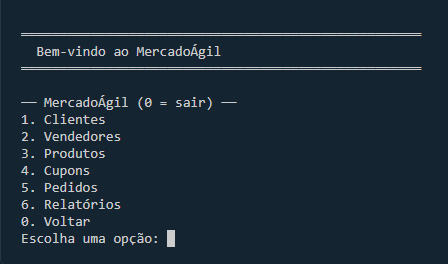
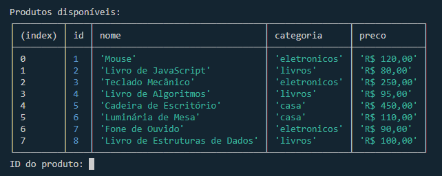
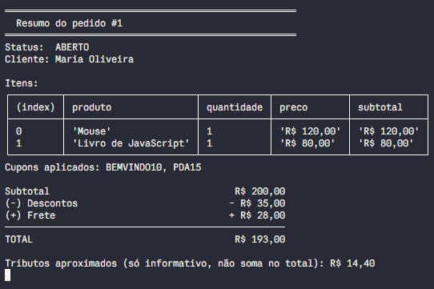
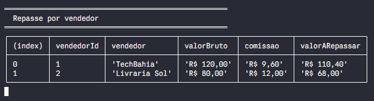

# MercadoÁgil: Microsserviço de Pedidos

[](https://github.com/Pedroaruana/Projeto-M1-MercadoAgil/actions/workflows/ci.yml)


Serviço de pedidos de um marketplace, feito em JavaScript puro com Node.js e executado no terminal. Projeto final do Módulo 1 do Programadores do Amanhã, desenvolvido pelo **Squad 5**.

O MercadoÁgil registrava pedidos numa planilha e tinha sempre os mesmos problemas: cupom aplicado errado, pedido confirmado sem estoque, frete calculado "no olho", repasse errado para o vendedor, ninguém sabia quanto faturou e o CPF do cliente aparecia em qualquer tela. Este serviço resolve cada um deles com regras testadas.

## Como rodar

Requisito: Node.js 18 ou mais novo.

```bash
git clone https://github.com/Pedroaruana/Projeto-M1-MercadoAgil.git
cd Projeto-M1-MercadoAgil
npm install
npm start
```

Ao abrir, o sistema carrega os dados de exemplo (`src/data/seed.js`) e mostra o menu principal:

```
1. Clientes   2. Vendedores   3. Produtos   4. Cupons   5. Pedidos   6. Relatórios   0. Voltar
```

Para rodar os testes:

```bash
npm test
```

### Roteiro rápido: o pedido de exemplo

1. `5` (Pedidos), `1` (Criar pedido), CPF `52998224725` (Maria, do Nordeste).
2. `2` (Adicionar item): produto `1` (Mouse), quantidade `1`. Repita com o produto `2` (Livro de JavaScript), quantidade `1`.
3. `4` (Aplicar cupom): `BEMVINDO10`. Repita com `PDA15`.
4. `5` (Ver resumo): o total deve ser **R$ 193,00**.
5. `6` (Confirmar pedido), `0` para voltar, `6` (Relatórios), `6` (Ver todos).

## Regras de negócio

### Estoque: tudo ou nada

- Ao confirmar, o pedido confere **todos os itens de uma vez** no estoque.
- Se faltar qualquer item, nada é confirmado e nada sai do estoque. A mensagem lista **todos** os itens em falta.
- Pedido confirmado dá baixa no estoque. Pedido confirmado e depois cancelado devolve os itens.
- O pedido só aceita mudanças (itens e cupons) enquanto estiver `aberto`. Os status são `aberto`, `confirmado` e `cancelado`.

### Cupons

| Tipo | O que faz | Exemplo |
| --- | --- | --- |
| `percentual` | tira uma porcentagem | `BEMVINDO10`: 10% |
| `fixo` | tira um valor em reais | `PDA15`: R$ 15,00 |
| `frete` | zera o frete | `FRETEZERO` |

1. Cupom vencido é recusado, mesmo que estivesse válido quando foi cadastrado (também é conferido de novo ao confirmar).
2. O subtotal precisa atingir o valor mínimo do cupom.
3. No máximo 2 cupons por pedido, e o mesmo cupom não entra duas vezes.
4. Cupom não cumulativo só pode ser usado sozinho.
5. O desconto total nunca passa de 30% do subtotal, e o total nunca fica negativo.

### Ordem de aplicação dos descontos

1. **Percentuais primeiro.** Se houver dois, o segundo incide sobre o que sobrou depois do primeiro.
2. **Fixos depois**, somados e limitados ao que ainda resta do subtotal.
3. **Frete por último:** o cupom de frete zera o frete e não entra na conta do desconto.
4. **Teto:** a soma de percentuais e fixos é cortada em 30% do subtotal.

Por que essa ordem: aplicar o percentual antes do valor fixo dá o mesmo resultado para qualquer ordem em que os cupons são digitados, então o total não depende do atendente.

### Frete

`taxa da região + R$ 1,50 por unidade`, um só por pedido, mesmo com vendedores diferentes.

| Norte | Nordeste | Centro-Oeste | Sudeste | Sul |
| --- | --- | --- | --- | --- |
| R$ 35,00 | R$ 25,00 | R$ 30,00 | R$ 20,00 | R$ 22,00 |

Frete grátis quando o valor já com descontos chega a **R$ 300,00**, ou quando o pedido usa cupom do tipo `frete`. Pedido vazio não paga frete.

### Tributos, comissão e repasse

Calculados sobre o valor dos itens, **antes dos descontos**. Cupom e frete são custo do marketplace e não diminuem o repasse.

| Categoria | eletronicos | livros | alimentos | vestuario | casa |
| --- | --- | --- | --- | --- | --- |
| Tributos (informativo, não soma no total) | 12% | 0% | 5% | 8% | 10% |
| Comissão do marketplace | 8% | 15% | 10% | 12% | 10% |

Repasse do vendedor = soma dos itens dele menos a comissão desses itens. Só pedidos **confirmados** geram repasse.

### Exemplo completo

Cliente do Nordeste compra 1 Mouse (eletrônicos, R$ 120,00, TechBahia) e 1 Livro de JavaScript (livros, R$ 80,00, Livraria Sol), com `BEMVINDO10` e `PDA15`:

```
Subtotal                              R$ 200,00
(-) BEMVINDO10: 10% de R$ 200,00    - R$  20,00
(-) PDA15: desconto fixo            - R$  15,00
(+) Frete: R$ 25,00 + 2 x R$ 1,50   + R$  28,00
TOTAL                                 R$ 193,00

Desconto total: R$ 35,00 (dentro do teto de 30% = R$ 60,00)
Tributos aproximados: 12% x 120,00 + 0% x 80,00 = R$ 14,40

Repasse:
TechBahia     R$ 120,00 - comissão 8% (R$ 9,60)   = R$ 110,40
Livraria Sol  R$  80,00 - comissão 15% (R$ 12,00) = R$  68,00
Comissão total do marketplace: R$ 21,60
```

Esse exemplo é um teste automático (`test/pedido-exemplo.test.js`): se alguma regra mudar, ele falha.

### Relatórios

Consideram **somente pedidos confirmados**: faturamento total, quantidade de pedidos, ticket médio, total de descontos, tributos e comissões, faturamento por categoria (valor dos itens antes dos descontos), repasse por vendedor (bruto, comissão e valor a repassar) e top 3 produtos mais vendidos.

## Estrutura de pastas

```
.
├── index.js                  # ponto de entrada: abre o menu
├── package.json              # "type": "module"
├── src/
│   ├── models/               # uma classe por arquivo
│   │   ├── Cliente.js, Vendedor.js, Produto.js, CupomDesconto.js
│   │   ├── Estoque.js        # verifica, dá baixa e devolve
│   │   └── Pedido.js         # orquestra as regras do pedido
│   ├── schemas/              # validação com Zod (safeParse)
│   ├── services/
│   │   ├── Marketplace.js    # classe principal: cadastros, pedidos e relatórios
│   │   └── relatorios.js     # funções dos relatórios financeiros
│   ├── config/regras.js      # frete, alíquotas, comissões, teto, limite de estoque baixo
│   ├── data/seed.js          # dados de exemplo carregados ao iniciar
│   ├── utils/                # dinheiro (arredondar, R$), CPF/CNPJ, resposta
│   └── cli/                  # só lê do teclado e mostra na tela
│       ├── menu.js, ui.js, adaptador.js
│       └── telas/            # cadastros, pedidos, relatórios
└── test/                     # testes com node:test
```

## Decisões do squad

- **O menu só lê e mostra.** Quem decide é o `Marketplace` e as classes. O `adaptador.js` é a única ligação entre o menu e os métodos do serviço. *Por quê:* assim a regra não se espalha pelas telas, e trocar o menu não mexe em nenhuma conta.
- **Toda resposta é `{ ok, dados }` ou `{ ok, erros }`.** Nenhum dado inválido derruba o programa. Os erros são mensagens em português, específicas por campo. *Por quê:* um serviço precisa sempre responder, e o menu só precisa ler o resultado.
- **Encapsulamento.** Estoque e status do pedido só mudam por métodos (`confirmar()`, `cancelar()`), com campos privados (`#`) e getters. *Por quê:* ninguém consegue marcar um pedido como confirmado sem passar pela conferência de estoque.
- **Dois percentuais seguidos são aceitos**, cada um sobre o que sobrou do anterior. *Por quê:* o enunciado fala em "primeiro os percentuais" no plural, e aplicar sobre o restante nunca gera desconto maior que o subtotal.
- **CPF fora das respostas.** O `Marketplace` tira o CPF com `rest` antes de devolver qualquer dado de cliente (LGPD). O CPF só serve para procurar. *Por quê:* é o problema do cenário ("o CPF aparece em qualquer tela"), então a regra fica na fonte e não depende de cada tela lembrar.
- **CPF e CNPJ validados com os dígitos verificadores**, aceitando pontuação. *Por quê:* checar só o tamanho deixaria passar números inventados.
- **Excluir produto** é recusado se ele está em pedido aberto (a mensagem diz quais pedidos). Pedido confirmado ou cancelado não bloqueia. *Por quê:* pedido aberto ainda vai ser confirmado e precisa do produto; os demais já estão fechados.
- **Cupom é conferido de novo ao confirmar.** *Por quê:* ele pode vencer entre a aplicação e a confirmação.
- **Valores arredondados em 2 casas** em toda conta com dinheiro, sem erros como `14.399999`.
- **Sem `for` e `while`** para processar dados: tudo com `map`, `filter`, `find`, `findIndex` e `reduce`. O `while` existe só para manter o menu aberto.
- **Dados em memória.** O seed é carregado uma vez ao iniciar. *Por quê:* carregar de novo duplicaria os produtos.
- **Trabalho por pull request.** `main` protegida, uma branch por tarefa e um revisor de outra dupla em cada PR (veja o `CONTRIBUTING.md`).

## Desafios do squad

- **Conflito entre PRs.** Dois PRs (relatórios e buscas) alteraram o `Marketplace.js` ao mesmo tempo e deram conflito. Resolvemos atualizando a branch com a `main` e mantendo os dois conjuntos de métodos.
- **Integração do menu.** As telas foram feitas com um `Marketplace` de mentira enquanto o real não existia. No fim, o `npm start` ainda abria o menu de teste. Um PR final ligou o menu ao `Marketplace` real e ao seed.
- **Relatório de faturamento incompleto.** A primeira versão não incluía tributos e comissões. A revisão do PR pegou, e o relatório foi ajustado.
- **Ordem dos PRs.** Algumas tarefas dependiam de outras. Resolvemos começando pelas partes independentes e testando com dados de exemplo até a dependência chegar.

## Extras

- Produto só pode ser cadastrado com vendedor existente (e preço e quantidade válidos).
- Alerta de estoque baixo, em Relatórios (limite em `src/config/regras.js`).
- Histórico de pedidos por cliente, em Pedidos, com o total gasto em pedidos confirmados.

## Quem fez o quê

| Pessoa | Parte |
| --- | --- |
| Pedro Aruanã | Pedido: frete e total, cupons, confirmar e cancelar; métodos de pedido no `Marketplace`; teste do exemplo de R$ 193,00; menu final; histórico por cliente; líder do squad |
| Alexsander | Pedido: itens, ordem dos descontos e teto de 30%, tributos, comissão e repasse, casos extremos; alerta de estoque baixo |
| Lucas | CRUD do `Marketplace`, buscas, CPF fora da resposta, validação de cupom |
| Daniel | Models, schemas Zod, validação de CPF e CNPJ, excluir produto em pedido aberto |
| Yasmim | Menu inicial, relatório de faturamento, valores em R$ e mensagens claras, testes do cadastro de produto |
| Stefany | `seed.js`, relatórios de categoria, repasse, top 3, tributos e comissão, métodos de relatório no `Marketplace` |
| Poliana | `Estoque`, telas do menu integradas ao `Marketplace` |

## Prints do terminal

Menu principal, com os dados de exemplo já carregados:



Produtos do seed, mostrados ao adicionar itens ao pedido:



Resumo do pedido de exemplo, com os dois cupons aplicados (total de R$ 193,00):



Relatório de repasse por vendedor, depois de confirmar o pedido:



## Links

- Repositório: https://github.com/Pedroaruana/Projeto-M1-MercadoAgil
- Post no LinkedIn: _(adicionar o link depois de publicar)_

## Licença

MIT. Veja o arquivo `LICENSE`.
